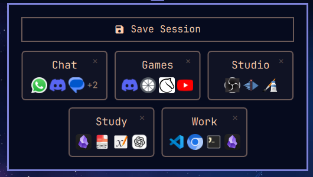

# Omarchy Sessions

Save the windows of a workspace as a named session and bring them back, apps and layout, with one click from the Omarchy bar.



- **Save Session** stores the apps open on the current workspace, with their tiling arrangement and floating windows.
- Each saved session is a card with its name and the icons of its apps. **Click a card** to restore it. The **✕** in the corner deletes it after a second click.
- A session opens on the current workspace if it is empty. Otherwise it opens on the first empty one, so it never mixes with what you already have open.
- While a session restores, a thin ring around the bar icon fills up as the apps appear. It ends in your theme's green when everything was placed, yellow when something was missing, and red when the restore failed.

## Install

```sh
omarchy plugin add https://github.com/csnasci/omarchy-sessions.git --enable
```

## Requirements

- Omarchy with **Hyprland 0.55 or newer using the Lua config** (`hyprland.lua`). Tested on Omarchy 4.5 with Hyprland 0.56.2.
- `python3`, `uwsm` (`uwsm-app`) and `gtk3` (`gtk-launch`). All of them ship with Omarchy.

## How it works

Saving records each window of the workspace: its class, position, size, whether it floats, and the `.desktop` entry that launches it (matched by `StartupWMClass`, then by file name).

Restoring takes three steps:

1. **Launch.** Every app opens through its `.desktop` entry with `uwsm-app -- gtk-launch <id>`, the same way Omarchy's launcher opens it. This covers web apps, Flatpaks and Electron apps without special cases.
2. **Wait.** The plugin waits for the real windows. Splash screens come and go, and some apps rename their window after it opens. Windows that land on another workspace are brought over.
3. **Arrange.** [hypr-layout](https://github.com/leftydevkit/hypr-layout) rebuilds the tiling tree, split ratios and floating geometry.

Windows on other workspaces are never moved or closed. During the launch the plugin turns Hyprland's `misc:focus_on_activate` off, so an app cannot pull you to another workspace, and turns it back on afterwards.

Sessions live in `~/.local/share/omarchy-sessions/<name>.json`. Logs of the last 30 runs live in `~/.local/state/omarchy-sessions/logs/`.

## Keyboard and scripts

The panel's actions are also available over IPC, for keybindings or autostart:

```sh
omarchy-shell omarchy-sessions toggle            # open / close the panel
omarchy-shell omarchy-sessions save Work         # save the current workspace as "Work"
omarchy-shell omarchy-sessions restore Work      # restore it
omarchy-shell omarchy-sessions remove Work       # delete it
omarchy-shell omarchy-sessions list
```

The same commands work without the shell through `bin/omarchy-sessions list | save | restore | delete <name>`.

## Limitations

- **Single-window apps.** Some apps keep a single window, such as GNOME Disks, and Spotify or Discord in some setups. If one is already open on another workspace, it does not open a second window. The session then restores without it and the notification says where it is. Hyprland marks that workspace as urgent, which shows as red in the workspace widget.
- **Terminals** come back as fresh terminals. What ran inside them, and their working directory, is not restored.
- **App state** is the app's own business. A restore reopens apps; it does not reopen documents or tabs unless the app does that by itself.

## Remove

```sh
omarchy plugin remove io.github.csnasci.sessions
rm -rf ~/.local/share/omarchy-sessions ~/.local/state/omarchy-sessions   # saved sessions and logs, if you want them gone
```

## Credits

The layout engine is a vendored copy of [hypr-layout](https://github.com/leftydevkit/hypr-layout) by leftydevkit (MIT, commit `f51756f`), with three local changes listed in [`vendor/hypr-layout.patch`](vendor/hypr-layout.patch):

1. Floating windows are no longer counted as tiles, so arrangement is not skipped ([leftydevkit/hypr-layout#1](https://github.com/leftydevkit/hypr-layout/issues/1)).
2. `splitratio` is applied as an exact value. On Hyprland 0.56 a bare value is a delta (same issue).
3. `HYPR_LAYOUT_POOL_WORKSPACE` limits window reuse to one workspace.

Its license is in [`vendor/LICENSE.hypr-layout`](vendor/LICENSE.hypr-layout).

## License

MIT
